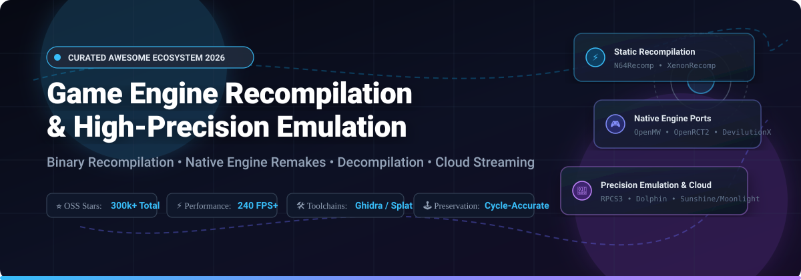

# Awesome-Game-Engine-Recompilation-Emulation


  





  
  
  
  
  



# ⚙️ Top Game Engine Recompilation & Emulation

**Curated List of SaaS/Commercial Platforms & Open-Source GitHub Projects**  
*Focused on Static Binary Recompilation (N64Recomp, XenonRecomp), Reverse-Engineered Native Engine Reimplementations, High-Precision Emulators & Self-Hosted Cloud Gaming*  
**Last updated: November 2026**

This repository tracks notable **SaaS/Commercial platforms** and **open-source projects** for **Game Engine Recompilation & Emulation**. These tools power static console-to-PC binary recompilation (`N64Recomp`, `XenonRecomp`, `raymanoriginsrecomp`), clean-room native game engine reimplementations (`OpenMW`, `DevilutionX`, `OpenRCT2`, `Ship of Harkinian`), decompilation toolchains (`Ghidra`, `decomp.me`, `Splat`), cycle-accurate console emulators, and self-hosted remote game streaming (`Sunshine` + `Moonlight`) for preservationists, reverse engineers, and native-port developers.

**Examples** include Xbox Cloud Gaming (Microsoft), Amazon Luna, GeForce NOW (NVIDIA), Steam Remote Play (Valve), Boosteroid, Shadow PC (OVHcloud / Octave Klaba), Antstream Arcade, Blacknut, Utomik, and RetroArch Cloud / Hosted Web Ecosystem (the category leaders).

**🚀 Open-source emphasis**: This section is heavily expanded with every major active project for static binary recompilation (`belmantegu/raymanoriginsrecomp`, `N64Recomp`, `XenonRecomp`, `Zelda64Recomp`, `UnleashedRecomp`), decompilation toolchains (`Ghidra`, `decomp.me`, `Splat`, `m2c`), native open-source engine reimplementations (`OpenMW`, `OpenRCT2`, `DevilutionX`, `Ship of Harkinian`, `OpenLara`, `CorsixTH`, `OpenRA`), and flagship emulators (`Dolphin`, `PCSX2`, `RPCS3`, `Xenia`) — ideal for preservation engineers unlocking 60–240 FPS native widescreen ports.

🤝 Contributions welcome! Open a PR to add/update entries. Keep descriptions factual and link to official sites.

## 📑 Table of Contents
- [📊 Sector Overview & Market Dynamics](#-sector-overview--market-dynamics)
- [☁️ SaaS/Hosted & Commercial Platforms](#️-saashosted--commercial-platforms)
- [💻 Open-Source GitHub Projects](#-open-source-github-projects)
- [🛠️ How to Contribute](#️-how-to-contribute)
- [⚠️ Disclaimer](#️-disclaimer)
- [💖 Support & Thank You](#-support--thank-you)

## 📊 Sector Overview & Market Dynamics

The global Cloud Gaming, Retro Preservation & Game Engine Porting market is valued at approximately **$10.2B–$13.5B+ in 2026**, expanding at a ~20%–26% CAGR propelled by cloud-streamed back-catalogs, handheld PC gaming, and breakthrough static-recompilation techniques (`N64Recomp`, `XenonRecomp`). The commercial cloud-streaming layer exhibits **strong winner-take-most consolidation** around Microsoft Xbox Cloud Gaming, NVIDIA GeForce NOW, Amazon Luna, and Valve Steam Remote Play, whereas the **static recompilation, decompilation, and native engine-reimplementation ecosystems are 100% open-source driven**—turning classic MIPS/PowerPC console binaries into native, ray-traced, high-refresh-rate PC ports.

## ☁️ SaaS/Hosted & Commercial Platforms

*Sorted descending by company valuation / annual revenue scale.*

| Platform | Description | Company Scale (Valuation / Revenue) | Starting Paid Tier | Free Tier / Trial Limit |
| :--- | :--- | :--- | :--- | :--- |
| **[Xbox Cloud Gaming (Microsoft)](https://xbox.com)** | Cloud console streaming service running Xbox Series X server blades to stream hundreds of modern and backward-compatible games across devices. | **Part of Microsoft Corp.** (~$245B+ annual revenue; ~$3T+ market cap) | **$9.99 / month** (Game Pass Core/Standard with select cloud games) or **$19.99 / month** (Game Pass Ultimate) | **Forever Free Fortnite Cloud Access** (Free cloud streaming of *Fortnite* with a free Microsoft account; 14-day Game Pass trial promos) |
| **[Amazon Luna](https://amazon.com)** | Cloud gaming service integrated with Amazon Prime, Ubisoft+, and GOG, streaming PC and retro titles across Fire TV, browsers, and mobile. | **Part of Amazon.com, Inc.** (~$630B+ annual revenue; ~$2T+ market cap) | **$9.99 / month** for Luna+ (or included at **$0 extra cost** with Amazon Prime membership) | **Forever Free Rotating Prime Selection** (Included free for Amazon Prime subscribers + 7-day Luna+ free trial for new users) |
| **[GeForce NOW (NVIDIA)](https://nvidia.com)** | Cloud RTX GPU game-streaming platform running owned PC libraries from Steam, Epic, Xbox, and GOG at up to 4K/120fps or 1080p/240fps. | **Part of NVIDIA Corp.** (~$130B+ annual revenue; ~$3T+ market cap) | **$9.99 / month** ($49.99/6 mos Performance) or **$19.99 / month** ($99.99/6 mos Ultimate RTX 4080/5080) | **Forever Free Basic Tier** (Ad-supported **1-hour session limit** with standard queue access and basic cloud rig) |
| **[Steam Remote Play (Valve)](https://steampowered.com)** | Built-in low-latency game streaming and Remote Play Together service allowing players to stream local PC/SteamOS games and emulators anywhere. | **~$10B–$15B+ Est. Valuation** (~$10B+ est. annual Steam revenue; privately held) | **$0 / Free Platform Feature** (30% standard Steam storefront revenue share for game publishers) | **100% Free Forever** (Unlimited 4K/120fps local & WAN remote play, Steam Input controller mapping, and Remote Play Together) |
| **[Shadow PC (OVHcloud / Octave Klaba)](https://shadow.tech)** | Full cloud Windows 11 gaming and development PC streamed at low latency for running custom emulators, recompiled PC ports, and modding suites. | **Backed by Octave Klaba / OVHcloud** (~€1B+ OVHcloud group revenue) | **$19.99 / month** (Discovery tier) or **$32.99 – $49.99 / month** (Boost / Power RTX GPU tiers) | **No Perpetual Free Tier** (Occasional first-month promo discounts; full Windows cloud VM requires active monthly subscription) |
| **[Boosteroid](https://boosteroid.com)** | Leading European independent cloud gaming platform streaming AAA and classic PC titles at up to 4K/120fps across browsers, Linux, macOS, and TVs. | **~$100M–$200M Est. Valuation** (~$20M–$40M est. ARR; rapid EU/US server expansion) | **€7.49 / month** billed annually (€89.89/yr) or **€9.89 / month** monthly for Ultra 4K | **No Perpetual Free Tier** (Free account enables network latency/bitrate testing prior to subscribing) |
| **[Antstream Arcade](https://antstream.com)** | Official cloud retro-gaming platform streaming 1,300+ licensed arcade, Amiga, Commodore, SNES, and PlayStation classics with cloud saves. | **~$30M–$50M Est. Valuation** (~$5M–$10M est. ARR; $20M+ VC funding) | **$3.99 / month** ($39.99/yr annual subscription) or **$99.99 one-time** Lifetime pass | **Forever Free Ad-Supported Tier** (Free retro game play supported by pre-roll ads and tournament gems) |
| **[Blacknut](https://blacknut.com)** | Family-oriented cloud gaming subscription service streaming 500+ curated PC, console, and classic arcade titles across up to 5 simultaneous profiles. | **~$20M–$40M Est. Valuation** (~$5M–$10M est. ARR; French cloud-gaming provider) | **$14.99 / month** (or **€14.99 / month** for up to 5 player profiles) | **14-Day Free Trial** (Unlimited streaming across the 500+ game catalog during the 14-day trial period; no perpetual free tier) |
| **[Utomik](https://utomik.com)** | Subscription cloud and fast-chunked-download PC/retro gaming platform curating 1,400+ indie, classic, and family titles on PC and smart TVs. | **~$15M–$30M Est. Valuation** (~$5M+ est. ARR; Dutch cloud-gaming company) | **$8.99 / month** for PC plan or **$11.99 / month** for PC + Cloud TV plan | **14-Day Free Trial** (Unlimited access to the 1,400+ game catalog during the 14-day evaluation period; no perpetual free tier) |
| **[RetroArch Cloud / Hosted Web Ecosystem](https://libretro.com)** | Browser-hosted WebAssembly Libretro player and Steam/App Store cloud-save ecosystem running open-source emulator cores directly in browsers. | **Non-Profit / Community Open-Source Project** (Patreon & bounty funded) | **$0 / Free Open-Source** (Optional Patreon sponsorship for buildbot servers) | **100% Free Forever** (Unlimited browser WebAssembly emulation via `://libretro.com` and Steam/App Store cloud sync) |

## 💻 Open-Source GitHub Projects

| Project | License / Hosting Cost | Free Tier / Self-Hosted Limit | Description |
| :--- | :--- | :--- | :--- |
| **[Rayman Origins Recomp (`belmantegu/raymanoriginsrecomp`)](https://github.com)** | **Open-Source** ($0 native static recompilation project; requires user game assets) | **100% Free forever** (Unlimited native PC compilation, high-refresh-rate rendering, and modding exploration) | Open-source static recompilation project translating *Rayman Origins* console/binary code into a native modern PC executable. |
